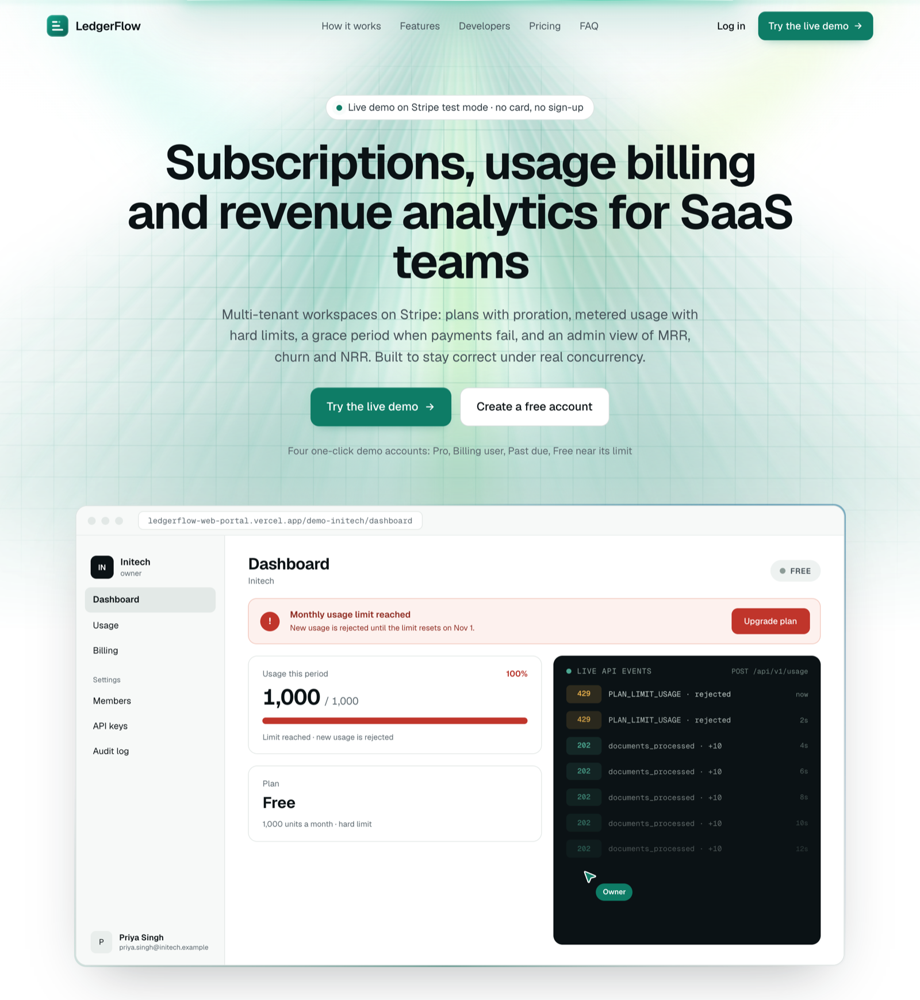
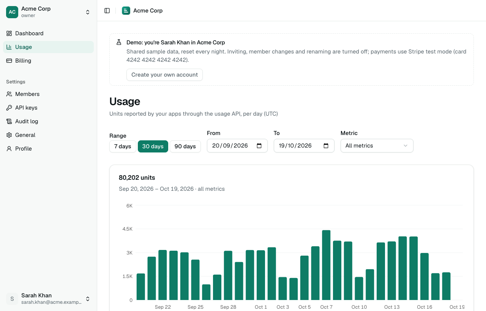
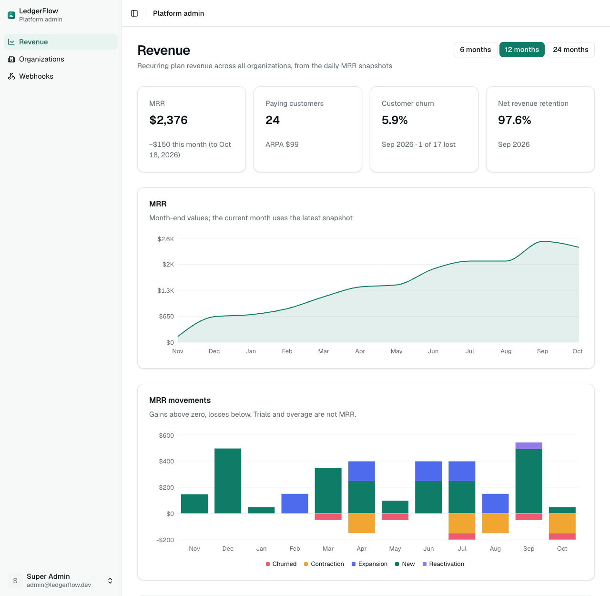
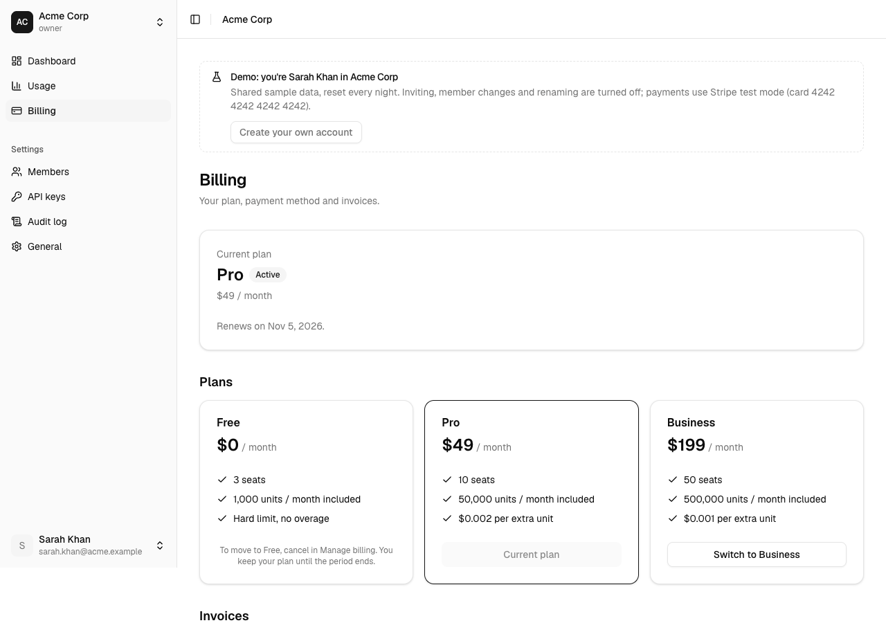
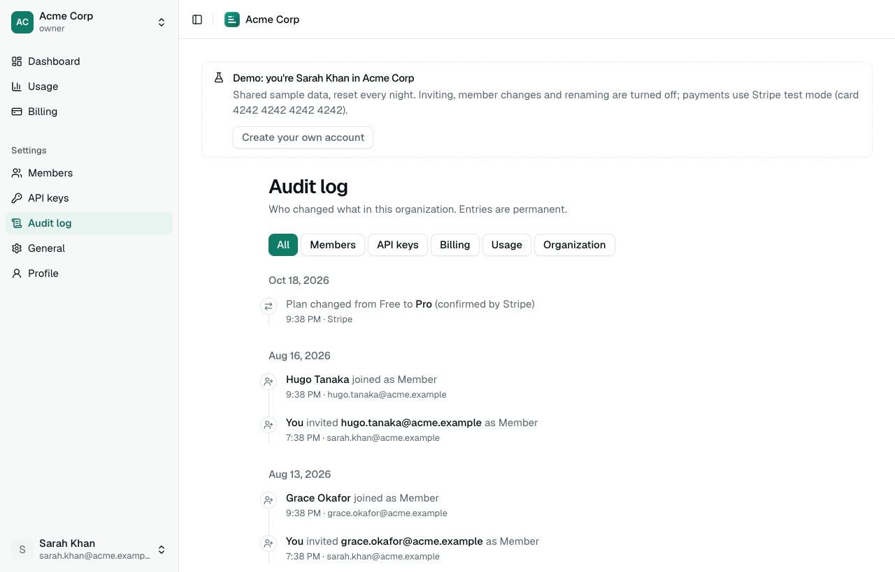
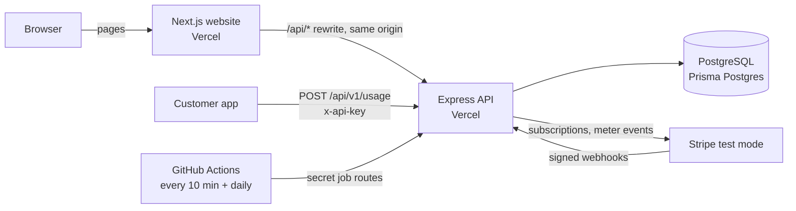

# LedgerFlow

**Multi-tenant SaaS billing and usage analytics: organizations subscribe through Stripe, report metered usage through an API, and see usage and revenue dashboards.**

[](https://github.com/ashikurriyal/Multi-Tenant-SaaS/actions/workflows/ci.yml)

**Live demo:** [ledgerflow-web-portal.vercel.app](https://ledgerflow-web-portal.vercel.app) · a landing page with a scripted product walkthrough · one-click demo accounts on the login page · payments in Stripe test mode



## Try it

Open the [login page](https://ledgerflow-web-portal.vercel.app/login) and pick a demo account. No password, no sign-up.

| Demo account | What to look at |
| --- | --- |
| Owner · Acme (Pro) | Usage near 80% with the warning banner, plan change with a real proration preview from Stripe, billing portal, API keys, audit log |
| Billing user · Acme | Can manage billing; cannot manage members or API keys (role-based access) |
| Owner · Globex (past due) | A genuinely failed renewal in Stripe: payment-failed banner and grace period |
| Owner · Initech (Free) | 95% of the Free limit; at 100% new usage is rejected and upgrade prompts appear |

Test card: `4242 4242 4242 4242`, any future date, any CVC. The demo organizations are shared and rebuilt every night, so inviting people, changing members and renaming are turned off there. [Create your own account](https://ledgerflow-web-portal.vercel.app/register) to try those.

| | |
| --- | --- |
|  |  |
| **Usage**: daily series from rollups, range and metric in the URL | **Platform admin**: MRR, movements, churn, NRR, ARPA from daily snapshots |
|  |  |
| **Billing**: Stripe Checkout, plan changes with proration, Customer Portal | **Audit log**: every member, key and billing change, with who did it |

## Architecture



The website and the API are separate Vercel projects, and the website proxies `/api/*` to the API, so the browser only ever talks to one origin and the httpOnly refresh cookie stays first-party ([ADR-007](docs/adr/ADR-007-same-origin-rewrite.md)). Stripe is the source of truth for billing: webhooks land in an inbox table and are processed exactly once, and a nightly job reconciles every subscription ([ADR-002](docs/adr/ADR-002-stripe-source-of-truth.md)). Vercel keeps nothing running between requests, so background work (emails, webhook retries, usage reporting, rollups, MRR snapshots, the demo reset) runs as secret-protected routes called on a schedule by GitHub Actions.


18 tables in one shared PostgreSQL database; every tenant-owned row carries `organizationId` ([ADR-001](docs/adr/ADR-001-shared-database-tenancy.md)). Usage is stored three ways for three jobs: raw `usage_events` (idempotency and billing), `usage_counters` (the atomic limit) and `usage_daily_rollups` (charts). Revenue analytics read `mrr_snapshots`, one row per organization per day ([ADR-005](docs/adr/ADR-005-daily-mrr-snapshots.md)).

## Engineering highlights

- **Usage limits that can't be overrun.** The limit check and the increment are one SQL statement (`INSERT … ON CONFLICT DO UPDATE … WHERE units + q <= limit`), so concurrent requests queue on the counter row. 50 simultaneous requests of 30 units against a 1,000-unit limit: **exactly 33 accepted, counter 990**, never above. Repeated `idempotencyKey`s count once, also when 20 arrive at the same moment. [`usage.service.ts`](server/src/modules/usage/usage.service.ts) · [ADR-004](docs/adr/ADR-004-postgres-atomic-counters.md)
- **Exactly-once Stripe webhooks.** Raw-body signature check, an inbox keyed by the event id, a fast `200` and processing after the response, atomic claiming, exponential backoff (2/4/8/16 min, 5 attempts) and recovery of stuck rows. Handlers re-fetch the object from Stripe and lock the subscription row, so late, repeated and out-of-order events all end in the current state. [`webhook.processor.ts`](server/src/modules/webhook/webhook.processor.ts) · [`billing.sync.ts`](server/src/modules/billing/billing.sync.ts) · [ADR-003](docs/adr/ADR-003-refetch-stripe-objects.md)
- **Tenant isolation enforced in one place.** A tenant-scoped Prisma client ANDs `organizationId` into every query and forces it on every write; other organizations' resources answer `404`, never `403`. `npm run verify:tenancy` runs 40 isolation and permission checks against a real database in CI. [`tenantPrisma.ts`](server/src/lib/tenantPrisma.ts) · [`verify-tenancy.ts`](server/scripts/verify-tenancy.ts)
- **Metered billing without double charges.** Billable usage goes to a Stripe Billing Meter with an identifier derived from the event, so a retried or concurrent run can't bill twice; verified against Stripe's own meter total. [`reportUsage.ts`](server/src/jobs/reportUsage.ts)
- **Revenue analytics from daily snapshots.** MRR, new/expansion/contraction/churn/reactivation, customer churn, NRR and ARPA, as pure functions checked against a worked example (`npm run check:metrics`). A month with missing snapshots carries the previous state forward instead of looking like mass churn. [`metrics.ts`](server/src/shared/metrics.ts) · [`admin.service.ts`](server/src/modules/admin/admin.service.ts)
- **Sessions that survive multiple tabs.** Refresh tokens rotate on every use and a reused one revokes the whole session; the client de-duplicates refreshes within a tab and takes turns across tabs with the Web Locks API, so two tabs never trip reuse detection. The access token lives only in memory. [`session.ts`](client/src/redux/api/session.ts) · [ADR-006](docs/adr/ADR-006-rtk-query-server-state.md)
- **A demo that's real.** Demo organizations are rebuilt nightly with real Stripe test subscriptions on test clocks: Acme is 12 days into its period, Globex's renewal genuinely failed. [`demo.service.ts`](server/src/modules/demo/demo.service.ts)
- **Measured.** Lighthouse (production build): pricing 97 mobile / 100 desktop, dashboard 84 mobile / 100 desktop, layout shift 0, accessibility 100. Every foreign key indexed; dashboard and admin queries under 3 ms on the seeded data.

## Tech stack

| Layer | Tools |
| --- | --- |
| Client | Next.js 16 (App Router), React 19, TypeScript, Tailwind CSS, shadcn/ui, Redux Toolkit + RTK Query, React Hook Form + Zod, Recharts |
| Server | Node.js 22, Express 5, TypeScript, Passport (local + JWT), Zod, Prisma 7 |
| Data | PostgreSQL (Prisma Postgres) |
| Payments | Stripe (test mode): Checkout, Customer Portal, Billing Meters, webhooks, test clocks |
| Hosting | Vercel (website + API), Prisma Postgres, GitHub Actions (CI and scheduled jobs): all free plans |

## Run it locally

Requirements: Node.js 22+ and a PostgreSQL database (local, or a free [Prisma Postgres](https://www.prisma.io/postgres) database).

```bash
# API → http://localhost:5050 (not 5000: macOS AirPlay Receiver uses that port)
cd server
cp .env.example .env      # set DATABASE_URL, the JWT secrets and SUPER_ADMIN_*
npm install               # also generates the Prisma client
npm run db:deploy         # apply the migrations
npm run db:seed           # plans + super admin
npm run dev

# Website → http://localhost:3000
cd client
cp .env.example .env.local
npm install
npm run dev
```

Optional:

- **Billing:** put a Stripe test key in `STRIPE_SECRET_KEY`, run `npm run stripe:setup` (products, prices, meter, Customer Portal) and keep `npm run stripe:listen` running for webhooks.
- **Sample data:** `npm run seed:demo` adds a year of revenue history for the admin charts; `DEMO_ENABLED=true` and `npm run demo:reset` create the one-click demo accounts.

### Scripts (server)

| Command | What it does |
| --- | --- |
| `npm run dev` | API with hot reload |
| `npm run db:deploy` / `db:migrate` | Apply migrations / create one in development |
| `npm run db:seed` | Plans and the super admin |
| `npm run stripe:setup` | Stripe products, prices, usage meter and Customer Portal (test mode), linked to the plans |
| `npm run stripe:listen` | Forward Stripe test webhooks to the local API |
| `npm run verify:tenancy` | 40 tenant-isolation and permission checks against the database |
| `npm run check:metrics` | Revenue metrics against the worked example in the SRS |
| `npm run seed:demo` | 40 sample organizations with 12 months of MRR history |
| `npm run demo:reset` | Rebuild the one-click demo accounts |

Both apps also have `build`, `lint` and `typecheck`.

## Documentation

- [Blueprint and SRS](docs/LedgerFlow.md): requirements, API reference, data model, business rules, jobs, security checklist
- [Architecture decision records](docs/adr/README.md)
- [Deployment guide](docs/deployment.md): Vercel, Prisma Postgres, Stripe, email, scheduled jobs, demo accounts (all free)
- [Postman collection](docs/postman/README.md): every endpoint, with local and production environments
- [ERD](docs/ledgerflow-erd.svg) · [SQL schema](docs/ledgerflow-schema.sql) · [Prisma schema](docs/schema.prisma)

## Git workflow

`main` is deployed; `development` integrates; every feature gets its own `feat/*`, `fix/*` or `chore/*` branch from `development` and merges back through a pull request. CI builds both apps and runs the tenancy checks against PostgreSQL on every pull request.
